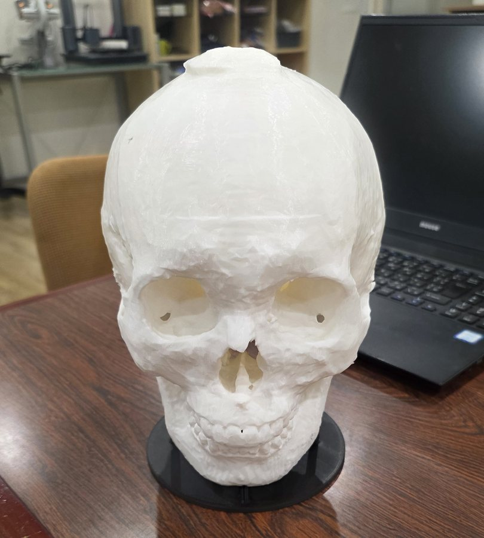

# head3Dv1 — DICOM 結合支援ツール

**分けて撮った CT を重なりを見ながら手で位置合わせして 1 つにつなぎ、3D プリント用の STL や、ビューアで開ける DICOM として書き出すデスクトップツール。**

[](#インストール)
[](#インストール)
[](https://github.com/Jin-hiroo/dicom-merge-tool-mac/releases/latest)
[](LICENSE)

[インストール](#インストール) ·
[使い方](#使い方) ·
[Mac アプリ版（ダウンロード）](https://github.com/Jin-hiroo/dicom-merge-tool-mac/releases/latest) ·
[検証（テスト）](#検証) ·
[ライセンス](#ライセンス)

<p>
  <a href="docs/images/printed-skull.jpg"></a>
  <a href="docs/images/merged-skull-3d.jpg"></a>
</p>

_左: 頭部 CT の 3 シリーズをこのツールで 1 つに結合し、書き出した STL を 3D プリントしたもの（黒い台座はこのツールの出力ではない）。
右: 同じ結合結果を 3D ビューで正面から見たところ。額を横切る線が、シリーズをつないだ継ぎ目。_

<p>
  <a href="docs/images/align-before.jpg"></a>
  <a href="docs/images/align-after.jpg"></a>
</p>

_同じ CT を横から見た位置合わせの前後。ベージュが基準のシリーズ（Fixed。先に 2 本を結合したもの）、水色が動かすシリーズ（Moving。頭頂部）。
左: 読み込んだ直後。DICOM の座標のままでは向きも位置も合っていない。右: 移動と回転のボタンで合わせた後。_

> **本ソフトウェアは診断用医療機器ではありません。**
> 研究・造形補助を目的としたツールであり、臨床診断には使用しないでください。
> 患者データはすべてこの PC 内でのみ処理され、外部送信は一切行いません。

## 特長

1 回で撮りきれずに複数のシリーズに分かれた CT は、そのままでは 1 つの模型にできない。
head3Dv1 では重なった部分を見ながら手で位置を合わせ、1 つのボリュームに結合してから書き出す。

- **何本でも順につなげる。** 2 本を結合すると結果が一覧に増えて次の基準（Fixed）になり、
  3 本目以降も同じ手順で足していける。
- **mm 単位で追い込める手動の位置合わせ。** 移動（X/Y/Z）と回転（Roll/Pitch/Yaw）のボタンや
  矢印キーで動かし、2D 断面の重ね合わせ（Fixed = グレー / Moving = 赤）とフッターの
  「重なり誤差」で確かめる。ボタン操作ではメッシュを作り直さないので 1 クリック数 ms で反映され、
  Undo / Redo もできる。
- **3D プリント用の STL と、ビューアで開ける DICOM。** STL は書き出すときにフル解像度でメッシュ化する。
  DICOM は派生データ（`DERIVED / SECONDARY`）として新しいフォルダに書き出すので、3D Slicer や
  PACS ビューアで開ける。書き出して読み戻すと spacing・向き・HU まで一致することをテストで確かめている。
- **16 GB のマシンで大きな CT を扱える。** ボリュームは `int16` の memmap に置いて RAM に全部は載せず、
  結合も Z 方向に分けて処理する。Apple M2 / 16 GB の実測で、512×512×600 を 2 本結合して 1.6 秒、
  STL 書き出し（200 万三角形）が 20.5 秒（[実測値](#実測値-apple-m2--16gb--512x512x600-を-2-本)）。
- **重い処理の間も操作できる。** 読み込み・結合・メッシュ化・書き出しは別スレッドで動き、
  進捗表示とキャンセルがある。
- **作業が消えない。** 終了時に自動保存し、次に起動したときに復元できる。
  時間をかけた位置合わせと結合結果も戻る（[セッションの保存と復元](#セッションの保存と復元)）。
- **手持ちの DICOM を 1 件ずつ確かめられる。** プレビューモードでは一覧で選んだシリーズだけを
  3D と 2D で表示する。シリーズごとに 3D の表示色も選べる（[2 つのモード](#2-つのモード)）。
- **データは手元から出ない。** ネットワークには接続せず、読み込みから書き出しまでこの PC の中で完結する。

<a href="docs/images/app-window.jpg"></a>

_上と同じ位置合わせの途中のメインウィンドウ。左: シリーズ一覧（シリーズ名は伏せてある）。
中央: 3D ビューと 2D 断面の重ね合わせ。右: HU 閾値、位置合わせ（移動・回転のボタンと数値）、結合と書き出し。
[Mac アプリ版](https://github.com/Jin-hiroo/dicom-merge-tool-mac)で撮影したため、3D ビュー上のボタン列が 2 行に折り返している（このリポジトリの `run.py` で起動すると 1 行に並ぶ）。_

## インストール

- Python 3.12（3.12 系で検証。VTK / PyQt5 / scipy のホイールが揃うため）
- macOS (Apple Silicon) で開発・検証。Windows / Linux でも動作するはずだが未検証
- メモリ 16 GB 以上を推奨（500 スライス超を 2 本扱う場合）

```bash
git clone https://github.com/Jin-hiroo/dicom-merge-tool.git && cd dicom-merge-tool
python3.12 -m venv .venv && ./.venv/bin/python -m pip install -r requirements.txt
./.venv/bin/python run.py
```

設定は不要。依存はすべて `.venv/` に入り、システムの Python には何も入れない。
システムの `python3` を直に叩くと依存が見つからないので、必ず `./.venv/bin/python` を使う。

**Mac で Python の環境構築をせずに使いたい場合**は、ダブルクリックで起動できる
[macOS アプリ版（head3Dv1.app）](https://github.com/Jin-hiroo/dicom-merge-tool-mac/releases/latest)
の DMG を入れる（Apple Silicon・macOS 14 以降）。中身はこのリポジトリのコードそのままで、操作も同じ。

> **Anaconda を使っている場合、`--system-site-packages` は付けないこと。**
> conda 版 PyQt5 は独自の Qt を同梱しており、pip 版 vtk と混ざると
> `Could not load the Qt platform plugin "cocoa"` で起動しなくなる。
> Qt スタックは PyPI 版で統一する。

> **患者データはリポジトリに入れないこと。**
> `scratch/`（作業用の memmap）と `sessions/`（保存したセッション。ボリューム実体と
> 元 DICOM の絶対パスを含む）は `.gitignore` 済み。`*.dcm` `*.raw` `*.stl` なども
> 拡張子で弾いている。

## 使い方

重なりのある CT シリーズを 2 本以上用意する。手元に DICOM が無いときは、ずれを仕込んだ
合成データ（2 シリーズ）で試せる。指定したフォルダは中身ごと作り直されるので、新しいフォルダを指定すること。

```bash
./.venv/bin/python tests/make_phantom.py /tmp/head3dv1-phantom
```

このフォルダを **DICOM フォルダを追加** で選ぶと、`PHANTOM A (lower)` と `PHANTOM B (upper)` が一覧に出る。
ここから先の手順は、手元の CT でも合成データでも同じ。

1. **DICOM フォルダを追加** — 再帰走査して CT シリーズを検出する
2. シリーズを選んで **読み込む**（1 本目は自動で Fixed になる）
3. もう 1 本を読み込み **Moving に設定**
4. **HU 閾値**を調整して **再セグメント**（既定は骨 = 250 HU）
   - **[表示色…]** でシリーズごとに 3D の色を決められる。パレットから 1 クリック、
     「その他の色…」で任意色、「既定に戻す」で役割の色に戻る。一覧の各行と
     ボタンに色見本が出る。指定した色は Fixed / Moving / プレビューの
     どれで表示されても使われるので、結合を重ねて一覧が伸びても見分けが付く。
     色替えはメッシュを作り直さないため、位置合わせの途中で変えても巻き戻らない
5. **X/Y/Z ボタンと Roll/Pitch/Yaw ボタン**で Moving を動かして位置合わせ
   - 下段の 2D 重ね合わせ（Fixed=グレー / Moving=赤）を見ると mm 単位で追い込める
   - フッターの **重なり誤差** が小さくなる方向が正しい
   - 矢印キー = X/Y、PageUp/Down = Z、Shift 併用で 10 倍ステップ
   - `Cmd+Z` / `Cmd+Shift+Z` で Undo/Redo
6. **結合を実行** — ボリューム空間で融合し、結果が新しいシリーズとして一覧に増える
7. 3 本目以降は 3〜6 を繰り返す（結合結果が自動的に Fixed になる）
8. 書き出す（用途で使い分け）
   - **STL を書き出す** — フル解像度で 1 回だけメッシュ化して単一 STL を出力。造形用
   - **DICOM を書き出す** — 結合結果を CT DICOM シリーズとして出力。ボリューム
     そのものが残るので 3D Slicer や PACS ビューアでそのまま開け、閾値を変えた
     再セグメントもやり直せる

## 2 つのモード

3D ビューの上のタブで切り替える。目的が違うので画面ごと分けている。

| | **位置合わせ** (Fixed / Moving) | **プレビュー** (単体確認) |
|---|---|---|
| 目的 | 2 つを重ねて結合に向けて追い込む | 手持ちの DICOM の中身を 1 件ずつ確認する |
| 3D 表示 | Fixed + Moving | **選択した 1 件のみ** |
| 2D 断面 | Fixed(灰) + Moving(赤) の重ね合わせ | 選択した 1 件のみ |
| 位置合わせ / 結合 | 有効 | 無効（画面から畳まれる） |
| 書き出し対象 | Fixed | **表示中のシリーズ** |

プレビューでは**一覧で選んだ瞬間にそれが表示される**（ボタン確定は不要）。
連続して選び替えても、生成中のメッシュは中断して最後に選んだものだけを処理する。

モードを往復しても **Fixed / Moving のメッシュは作り直さない**（表示を切り替えるだけ）。
位置合わせの途中で他のシリーズを確認しても、戻れば変換も視点もそのまま続けられる。
起動時は常に位置合わせモードから始まる。

## セッションの保存と復元

アプリを閉じたり、コードを更新して起動し直したりしても作業が失われないようにしている。
特に **時間をかけて追い込んだ位置合わせ** と **結合結果** は再現に手間がかかるので、
確実に残す。

### 自動保存（操作不要）

終了時に `sessions/_autosave/` へ自動保存し、次回起動時に復元を促す。
マニフェストだけを書き、ボリューム実体は `scratch/` を参照するだけなので一瞬で終わる。

> 以前は終了時に `scratch/` を全消ししていたため、作業内容が毎回失われていた。
> 現在は**セッションが参照していないファイルだけ**を掃除する
> （手動で掃除したい場合は「ファイル > 未使用の一時ファイルを削除」）。

### 明示保存（ファイル > セッションを保存…）

指定フォルダにボリューム実体ごとコピーして自己完結させる。`scratch/` を掃除しても壊れない。
「ファイル > セッションを開く…」で読み込む。

### 何が保存されるか

| 対象 | 保存方法 |
|---|---|
| 結合結果のボリューム | **実体を保存**（位置合わせのやり直しなしには再現できないため） |
| 元の DICOM シリーズ | フォルダパス + SeriesInstanceUID の**参照のみ**（数 GB を複製しない） |
| 位置合わせ | 6 自由度・回転中心・初期配置 base |
| Fixed / Moving の役割 | ○ |
| シリーズごとの表示色 | ○（未指定の行は役割ごとの既定色のまま） |
| セグメント設定 / ブレンド / 書出し設定 | ○ |
| ウィンドウ位置とサイズ | ○（QSettings） |

> **設定と作業状態は分けている。** HU 閾値やステップ幅などの「好み」は起動時に常に戻すが、
> **位置合わせの 6 自由度はセッション復元時のみ**戻す。特定の 2 シリーズに対する値なので、
> 別のデータを読み込んだときに古い変換が黙って効くのを避けるため。

起動時の復元プロンプトは `HEAD3DV1_NO_RESTORE=1` で抑止できる
（自動テスト用。まっさらな状態で始めたいときにも使える）。
`HEAD3DV1_SETTINGS_SCOPE` で設定の保存先を切り替えられる
（自動テストがユーザーの環境設定を上書きしないようにするため）。

元 DICOM フォルダを移動・削除した場合、その項目だけ復元できず警告に出る（残りは復元される）。
ボリューム実体はサイズを検証し、壊れていれば黙って読まずに報告する。

## DICOM 書き出しについて

書き出しは読み込み (`dicom_io.py`) のちょうど逆変換になっており、
**書き出し → 読み戻しで spacing / origin / direction と HU が完全に一致する**
（`tests/test_export_dicom.py` のラウンドトリップ試験で担保）。

- 保存先に `MERGED_CT_<n>series_<日時>/` を作り、その中に `IM00001.dcm` … を出力する
  （既存ファイルと混ざらないよう必ず新規フォルダを作る）
- **派生データとして明示**: `ImageType = DERIVED / SECONDARY / AXIAL`、
  由来を `DerivationDescription` に記録。元データと取り違えられないようにしている
- **患者・検査の同一性は維持**: PatientID / PatientName / StudyInstanceUID は
  元シリーズから引き継ぐ。`SeriesInstanceUID` と `FrameOfReferenceUID` は
  ジオメトリが変わっているので新規採番する
- 格納形式は実機 CT と同じ 16bit 符号なし + `RescaleIntercept=-1024`
- 詳細設定でシリーズ説明を指定できる。「閾値未満を空気にする」を有効にすると
  骨だけのボリュームとして書き出せる（通常はオフのまま、元の HU を残すのがよい）

## 設計上の 2 大制約

### UI をブロックしない
DICOM 読込・リサンプル・メッシュ化・STL 書出しはすべて `QThread` 上のワーカーで
実行し、進捗表示とキャンセルを備える（`app/workers/`）。
**位置合わせのボタン操作ではメッシュを作り直さない** — `vtkActor` の
UserTransform を差し替えるだけなので 1 クリック数 ms で反映される。

> ⚠️ ワーカースレッド内で `np.linalg.inv` を呼んではいけない。4x4 でも OpenBLAS の
> `dgetrf_parallel` を通り、QThread の既定スタックを溢れさせて SIGBUS で落ちる。
> 4x4 アフィンの逆行列は `app.core.transform.inv44()` を使う（LAPACK を通らない）。
> 保険として `WORKER_STACK_BYTES` でスタックも広げてある。

### 16GB を溢れさせない
- ボリュームは `int16` の `numpy.memmap`（`scratch/`）。RAM に全展開しない
- メッシュ化は `vtkFlyingEdges3D`（`skimage.marching_cubes` は float64 を返すので不使用）
- プレビューはダウンサンプル + 三角形数制限、フル解像度は書出し時だけ
- 結合は出力 Z スラブ単位で処理し、結果は memmap に直接書く
- 出力グリッドが予算超過ならスワップさせず自動的に spacing を粗くして明示表示する

予算は `app/config.py` の `MAX_VOLUME_BYTES` 等で調整できる。

### 実測値 (Apple M2 / 16GB / 512x512x600 を 2 本)

| 処理 | 時間 | ピーク RSS |
|---|---|---|
| 融合 (540 MB 出力) | 1.6 s | 1.9 GB |
| プレビューメッシュ | 0.8 s | — |
| STL 書出し (フル解像度 → 200 万三角形) | 20.5 s | 2.4 GB |
| DICOM 書出し (1,068 スライス / 542 MB) | 4.1 s | 618 MB |
| DICOM 読み戻し | 2.9 s | — |

> 性能上の要点: **間引きは平滑化より先に行う**こと。逆順だと数百万三角形を
> 平滑化することになり 350 秒かかった。またプレビューでは `vtkDecimatePro`
> を使う (`vtkQuadricDecimation` は 5 倍以上遅く、プレビューでは品質差が
> 見えない)。プレビューの三角形上限を高く取り「そもそも間引かない」ほうが
> 体感は速い。

## 検証

```bash
./.venv/bin/python -m pytest tests/ -q
```

患者データなしで検証できるよう、`tests/make_phantom.py` が既知のズレを持つ
合成 DICOM シリーズを生成する。正解の変換が分かっているため、融合結果を
解析的な正解オブジェクトと直接比較できる。

GUI を通した一連のワークフロー（読込 → 位置合わせ → 結合 → STL → 逐次結合）は
次で自動検証でき、各段階のスクリーンショットも保存される。

```bash
./.venv/bin/python tests/gui_drive.py /tmp/gui_out
```

環境だけを確認したい場合:

```bash
./.venv/bin/python tests/smoke_qt_vtk.py
```

## 構成

```
app/
├── config.py          メモリ予算・HU プリセット・既定値
├── core/
│   ├── dicom_io.py    シリーズ検出・HU 変換・memmap 化
│   ├── volume.py      Volume データモデル (memmap + アフィン)
│   ├── memory.py      バイト数見積もりと予算ガード
│   ├── transform.py   剛体 4x4・inv44・Undo スタック
│   ├── segment.py     閾値・最大連結成分・小島除去
│   ├── meshing.py     FlyingEdges・平滑化・デシメート
│   ├── resample.py    共通グリッドへのリサンプルと融合 ★中核
│   ├── blend.py       feather / max / mean
│   ├── metrics.py     重なり誤差 (ライブ) と Dice 係数
│   ├── export_stl.py  バイナリ STL 書出し
│   ├── export_dicom.py CT DICOM シリーズ書出し (読み込みの逆変換)
│   └── session.py     セッションの保存・復元
├── workers/           QThread ワーカー (進捗・キャンセル)
└── ui/                パネルとビュー
```

## ライセンス

[MIT License](LICENSE)。MIT で公開するのはこのリポジトリのコード。実行時に使うライブラリは
それぞれのライセンスに従う（PyQt5 は GPL v3、Qt は LGPL v3、VTK・NumPy・SciPy・scikit-image は BSD、
pydicom は MIT）。依存ライブラリごとまとめて配布する場合は、それらの条件にも従うこと。
